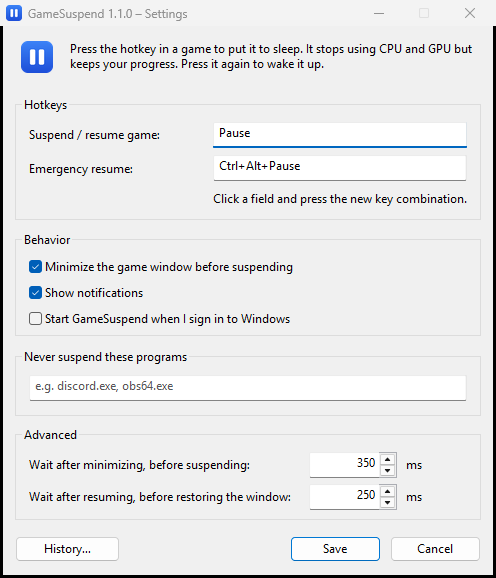

<p align="center">
  
</p>

<h1 align="center">GameSuspend</h1>

<p align="center">
  Put the game you're playing to sleep with one key, and wake it up with the same key.<br>
  While asleep it uses no CPU or GPU, yet stays in memory exactly where you left it.
</p>

<p align="center">
  <a href="https://github.com/Gargauth/GameSuspend/releases/latest"><b>⬇ Download GameSuspend.exe</b></a>
</p>

---

## How to use

1. Download `GameSuspend.exe` from [Releases](https://github.com/Gargauth/GameSuspend/releases/latest)
   and put it in a folder of its own. No installation needed.
2. Run it. The settings window opens on the first start; a blue icon appears next to the clock.
3. In a game, press **Pause**: the game window minimizes and the game goes to sleep. The icon turns into a moon.
4. Press **Pause** again: the game wakes up and its window comes back.

| Hotkey | Action |
| --- | --- |
| `Pause` | suspend the foreground game / resume the suspended game |
| `Ctrl+Alt+Pause` | emergency resume of the last suspended game |

Right-click the icon for **Settings…**, **History…** and **Exit**. Double-clicking the icon
resumes a suspended game, otherwise it opens the settings. Exiting GameSuspend, signing out
or shutting down always wakes a suspended game first.

## Settings

<p align="center"></p>

- **Hotkeys** – click a field and press any key combination (Ctrl, Alt, Shift and Win work).
- **Minimize the game window before suspending** – frees the screen; recommended for fullscreen games.
- **Start GameSuspend when I sign in to Windows** – no need to touch the Startup folder.
- **Never suspend these programs** – e.g. `discord, obs64`; `.exe` is added automatically.
- **Advanced** – delays between minimizing/suspending and resuming/restoring. Raise them if a
  game stutters after waking up.

Settings are stored in `settings.ini` next to the exe, the history in `gamesuspend.log`.

## How it works

GameSuspend calls `NtSuspendProcess` / `NtResumeProcess` from `ntdll` on the process that owns
the foreground window. The order matters:

- **suspend:** minimize window → wait → suspend process
- **resume:** resume process → wait → restore window

A suspended process can't respond to window messages, so the window is minimized while the
game still runs and restored only after it runs again.

System processes (`explorer.exe`, `dwm.exe`, `csrss.exe`, `winlogon.exe`, …), AutoHotkey and
GameSuspend itself can never be suspended, whatever the settings say.

## Troubleshooting

- **"access denied"** – the game runs as administrator or is protected by anti-cheat. Try running
  GameSuspend as administrator. Games with kernel anti-cheat can't be suspended.
- **Online games** usually lose their server connection while suspended.
- **A hotkey does nothing** – another app already uses it; GameSuspend tells you and opens the
  settings. Pick a different one.
- **A game stayed frozen** – press the emergency hotkey. **History…** shows what happened.

## Building from source

```sh
cargo build --release   # target/release/gamesuspend.exe
cargo test
```

The window layouts are in `assets/dialogs.rc`. The icons in `assets/` are generated by
`python assets/make_icons.py` (needs Pillow).

Pushing a tag that matches the version in `Cargo.toml` builds and publishes a release:

```sh
git tag v1.1.0
git push origin v1.1.0
```

## License

[MIT](LICENSE)
